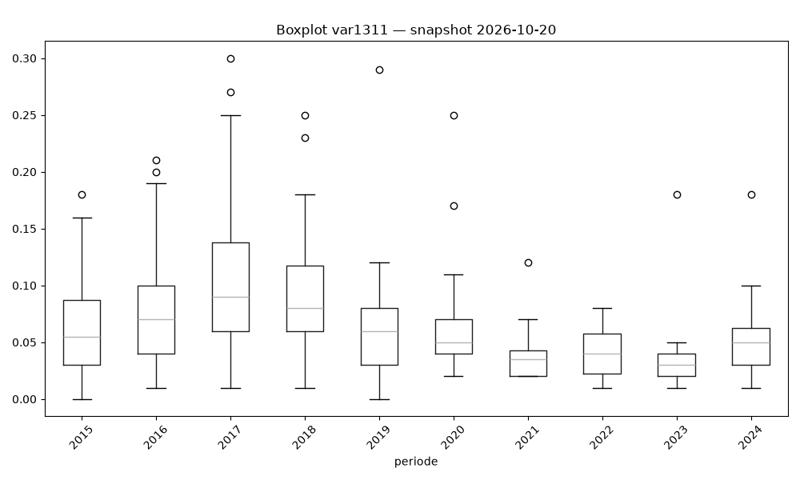
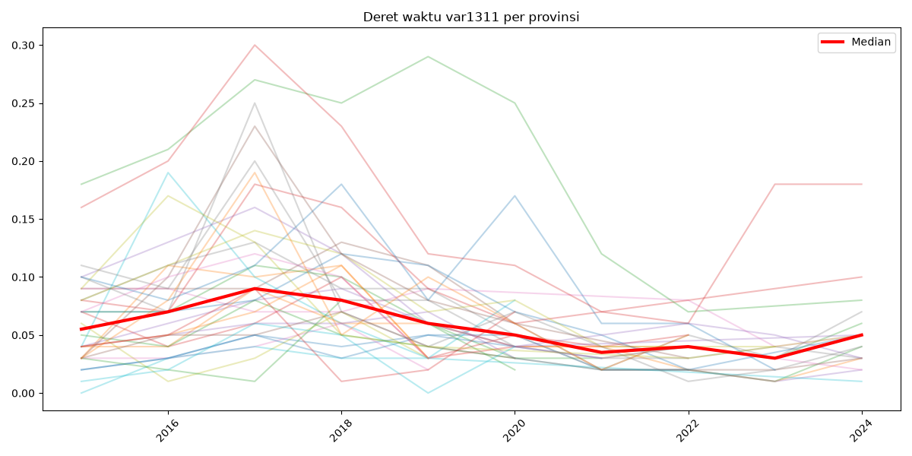

# Laporan Tahap 2: Profil dan Calon Anomali (Sprint 1)

**Penanggung Jawab:** Danil Nur Fadillah (124450103)

## 1. Tujuan
Melakukan profiling data mentah hasil ekstraksi untuk 6 seri utama (var1311, var1312, var2738, var2740, var1410, var1831), menemukan statistik deskriptif, dan menandai calon anomali tanpa melakukan perbaikan (imputasi/penghapusan) pada tahap ini.

## 2. Metodologi
- **Pemisahan Wilayah:** Baris agregat Indonesia (kode wilayah 9999) dipisahkan dari perhitungan statistik tingkat provinsi agar tidak bias.
- **Pembersihan Dasar:** Nilai kosong (NaN) di-drop secara spesifik untuk keperluan perhitungan statistik (bukan menghapus data di Silver).
- **Deteksi Anomali:** Menggunakan dua metode sekaligus, yaitu IQR (nilai di luar 1.5 *Interquartile Range*) dan Z-Score (nilai absolut > 3).
- **Visualisasi:** Membuat boxplot per periode dan deret waktu (time series) per provinsi untuk melihat sebaran dan tren data.

## 3. Ringkasan Statistik per Seri
Profil statistik berikut memakai tahun observasi dan snapshot terbaru per seri, setelah salinan
CSV/JSON dalam snapshot yang sama dideduplikasi. Tabel `profil_seri.csv` juga memuat ringkasan tiap
snapshot yang lebih lama. Angka terkini (jumlah baris provinsi di snapshot terbaru):

- **var1311:** 275 baris, rentang 0.0–0.3, rata-rata 0.069.
- **var1312:** 139 baris, rentang 34.28–91.92, rata-rata 69.290.
- **var2738:** 67 baris, rentang 34.37–81.66, rata-rata 55.206.
- **var2740:** 130 baris, rentang 0.35–100.0, rata-rata 58.966.
- **var1410:** 382 baris, rentang 17.44–97.7, rata-rata 75.087.
- **var1831:** 322 baris, rentang 0.0–98.78, rata-rata 81.164.

## 4. Daftar Calon Anomali
Berdasarkan IQR dan Z-Score, semua 71 kandidat lintas snapshot diberi kategori dan penjelasan di
`reports/tables/calon_anomali.csv`: 70 `outlier_asli`, 1 `patahan_seri`, dan 0 `galat_input`.
Nilai sama yang muncul pada snapshot berbeda tetap menjadi baris versi terpisah; 13 kandidat
var1311 tercatat pada kedua snapshot yang memuat seri tersebut.

Berikut adalah beberapa contoh temuan anomali yang paling mencolok:

1. **Nilai 0.0 pada Provinsi Baru (Seri var1831):**
   Ada 16 nilai **0.0** pada empat provinsi baru di Papua selama 2020–2023. Nilai cocok antara
   ekspor CSV dan JSON, dan metadata tidak menyebut nol sebagai sentinel missing. Hipotesis awal
   bahwa nol adalah missing tidak terbukti; kandidat dikategorikan `outlier_asli`, dipertahankan,
   dan selnya tetap terisi.

2. **Nilai Ekstrem Rendah pada var1410:**
   Pada seri `var1410` (Pencatatan Kelahiran), Provinsi **Papua Pegunungan** memiliki nilai **17.44** yang sangat jauh di bawah rata-rata nasional (75.09) dan ditandai oleh IQR serta Z-Score. Hal ini menunjukkan disparitas layanan pencatatan sipil yang sangat tinggi di wilayah tersebut.

3. **Nilai Ekstrem Tinggi pada var1311:**
   Pada seri `var1311` (Korban Kejahatan Kekerasan), Provinsi **Papua** dan **Papua Barat** secara konsisten memiliki nilai tertinggi (mencapai 0.3) yang ditandai sebagai anomali oleh IQR dan Z-Score dibandingkan provinsi lain yang rata-rata berada di bawah 0.1.

Saringan patahan tambahan mencatat indikasi var1410 pada 2020 dan 2022 di
`reports/tables/patahan_seri.csv`. Sumber tidak mengonfirmasi perubahan definisi/metode, sehingga
keduanya hanya ditandai. Kandidat var1410 dari Nusa Tenggara Timur tahun 2020 masuk kategori
`patahan_seri`; kandidat lain yang nilainya valid dikelompokkan sebagai outlier asli.

**Catatan Penting:** Outlier asli dan indikasi patahan tidak dihapus atau diperbaiki. Tidak ada
galat input yang terverifikasi sehingga tidak ada nilai yang dikoreksi.

## 5. Visualisasi
Berikut adalah contoh visualisasi (boxplot dan deret waktu) yang telah di-generate dan disimpan di folder `reports/gambar/`. Semua seri (var1311 s.d. var1831) memiliki gambar masing-masing.

**Boxplot:** Menunjukkan sebaran nilai antarprovinsi di setiap periode, memudahkan untuk melihat adanya nilai yang jauh menyimpang (outlier).

**Deret Waktu:** Menunjukkan tren nilai per provinsi dari tahun ke tahun. Garis merah tebal adalah nilai median provinsi.

**Catatan:** Sesuai dengan prinsip kerja Capstone, pada tahap ini belum dilakukan perbaikan, imputasi, atau penghapusan data. Data ekstrem hanya ditandai (flagging) murni untuk tujuan eksplorasi.